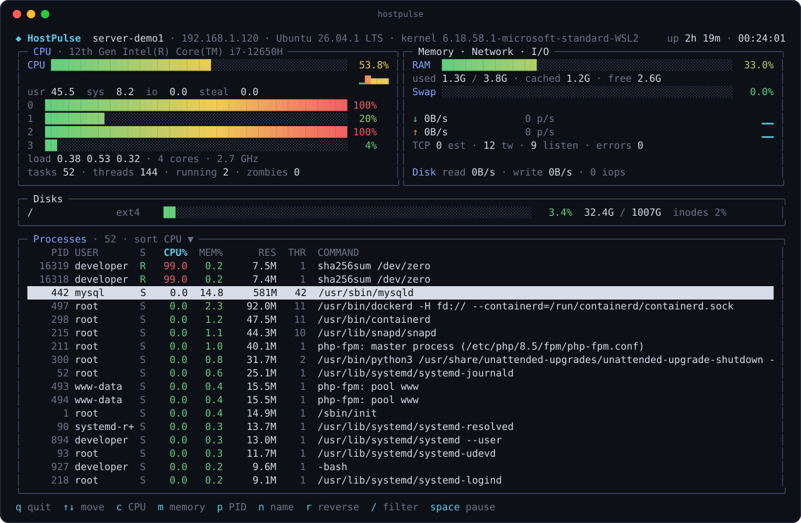

<p align="center">
  
</p>

<p align="center"><b>English</b> · <a href="README.md">Español</a></p>

# HostPulse

**A modern terminal system monitor in a single binary.** Like `htop`, but with colored bars, history sparklines and
panels that adapt to your terminal size. Runs on **Linux, macOS and Windows**.

Type `hostpulse` and watch live: CPU (total and per core), memory, swap, network, disk I/O, disks and every process.

<p align="center">
  
</p>
<p align="center"><sub>Real HostPulse capture on Linux under load (hostname, IP and user anonymized). The interface labels are in Spanish.</sub></p>

## Contents

- [Features](#features)
- [Installation](#installation)
- [Usage](#usage)
- [Notes per operating system](#notes-per-operating-system)
- [Privacy and security](#privacy-and-security)
- [Build from source](#build-from-source)
- [Open source and contributing](#open-source-and-contributing)
- [Author and contact](#author-and-contact)
- [License](#license)

## Features

- **CPU**: total usage with a color gradient, history sparkline, user/system/io/steal breakdown, one bar per core,
  load average, frequency, temperature (when the system exposes it) and task counts.
- **Memory and swap**: usage, cache and free memory.
- **Network**: download and upload speed with history, packets per second, errors and TCP connections.
- **Disk**: read, write and IOPS; usage per drive (and inodes where applicable).
- **Processes**: PID, user, state, instantaneous CPU (100 = one full core, like htop), memory, threads and the full
  command line. Sorting, live filter and keyboard selection.
- Adapts to the terminal size: on wide screens CPU and memory/network sit side by side.
- A single static binary: no server, no database, no configuration.

## Installation

The installer **clones the repository into a temporary folder, builds it, installs the `hostpulse` command and deletes
everything temporary** (the cloned repo and, if needed, a temporary Go toolchain). You do not need Go installed.
It requires `git` and `curl` (Linux/macOS) or `git` (Windows).

### Linux and macOS

```bash
curl -fsSL https://raw.githubusercontent.com/rasoftdev/HostPulse/main/get.sh | sudo bash

# without sudo it installs into ~/.local/bin:
curl -fsSL https://raw.githubusercontent.com/rasoftdev/HostPulse/main/get.sh | bash

# update: run the same command again
# uninstall:
curl -fsSL https://raw.githubusercontent.com/rasoftdev/HostPulse/main/get.sh | sudo bash -s -- uninstall
```

With `sudo` it installs into `/usr/local/bin`. Optional variables: `HOSTPULSE_PREFIX` (target folder),
`HOSTPULSE_REF` (branch or tag, default `main`) and `HOSTPULSE_REPO` (repository URL).

### Windows (PowerShell)

```powershell
irm https://raw.githubusercontent.com/rasoftdev/HostPulse/main/get.ps1 | iex

# update: run the same command again
# uninstall:
$env:HOSTPULSE_ACTION='uninstall'; irm https://raw.githubusercontent.com/rasoftdev/HostPulse/main/get.ps1 | iex
```

It installs into `%LOCALAPPDATA%\Programs\HostPulse` and adds it to the user `PATH` (no administrator needed).
**Open a new terminal** so the `PATH` is loaded.

> As with any `curl | bash` or `irm | iex`, read the script first if you do not trust the source:
> [`get.sh`](get.sh) · [`get.ps1`](get.ps1).

## Usage

```bash
hostpulse            # open the monitor
hostpulse -d 2       # refresh every 2 seconds (default 1)
hostpulse --no-color # no colors (the NO_COLOR variable is also honored)
hostpulse -v         # version
```

| Key | Action |
|---|---|
| `↑` `↓` / `j` `k`, `PgUp` `PgDn`, `Home` `End` | move the selection |
| `c` · `m` · `p` · `n` | sort by CPU · memory · PID · name (pressing the same key again reverses the order) |
| `r` | reverse the order |
| `/` | filter by command, user or PID (`Enter` accepts, `Esc` clears) |
| `space` | pause / resume |
| `q` / `Ctrl-C` | quit |

It needs a terminal of at least **60×14**. On Windows it works in Windows Terminal, PowerShell and cmd.

## Notes per operating system

| | Linux | macOS | Windows |
|---|---|---|---|
| CPU, memory, network, disk, processes | yes | yes | yes |
| CPU temperature | when sensors exist (`hwmon`) | usually unavailable | usually unavailable |
| TCP connections | yes | only with `sudo` | yes |
| Threads per process | immediate | fills in within a few seconds | fills in within a few seconds |

When a value is not available, HostPulse simply does not show it.

## Privacy and security

- It only **reads** system information (`/proc` and `/sys` on Linux; the system APIs on macOS and Windows).
- It **opens no ports, has no server and sends no data** anywhere. There is no telemetry.
- It changes nothing on the system or in your processes (it cannot kill processes or change their priority).
- To find the outgoing IP it opens a "connected" UDP socket (no packet is sent).

## Build from source

You need [Go](https://go.dev/dl/) 1.26 or newer.

```bash
git clone https://github.com/rasoftdev/HostPulse.git
cd HostPulse
go build -o hostpulse ./cmd/hostpulse     # build for your system
bash scripts/build.sh                      # binaries in dist/ for Linux, macOS and Windows (amd64 and arm64)
go test ./...
```

Layout: `cmd/hostpulse` (CLI) · `internal/tui` (interface: drawing, keys, panels) ·
`internal/sysinfo` (per-OS metric collection) · `get.sh` and `get.ps1` (installers).

## Open source and contributing

HostPulse is **free and open source software**. You may use, study, modify and redistribute it. Contributions are
welcome: open an issue to report a bug or suggest an improvement, or send a pull request (run `gofmt` and
`go vet ./...` first).

## Author and contact

Created by **Ricardo Alvarez** ([RASOFTDEV](https://github.com/rasoftdev)), also the author of
[DevDoctor](https://github.com/rasoftdev/DevDoctor).

- Email: [dev@ricardoalvarez.co](mailto:dev@ricardoalvarez.co)
- Website: [me.ricardoalvarez.co](https://me.ricardoalvarez.co)

Found a bug or want to propose a new feature? Open an issue or write to the contact email.

## License

HostPulse is free software under the **MIT license**: anyone may use, copy, modify and distribute it, including for
commercial purposes, as long as the copyright notice is kept. See the [LICENSE](LICENSE) file.
The software is provided "as is", without warranty of any kind.
