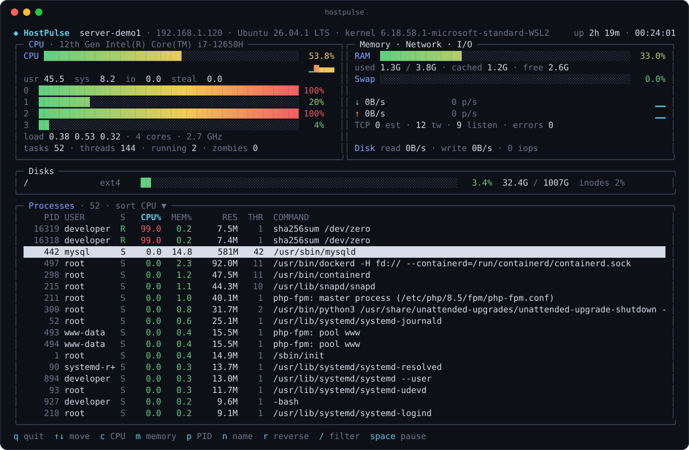

<p align="center">
  
</p>

<p align="center"><a href="README.en.md">English</a> · <b>Español</b></p>

# HostPulse

**Un monitor del sistema para la terminal, moderno y en un único binario.** Como `htop`, pero con barras de color,
minigráficas de historial y paneles que se adaptan al tamaño de tu terminal. Funciona en **Linux, macOS y Windows**.

Escribe `hostpulse` y verás en vivo: CPU (total y por núcleo), memoria, swap, red, E/S de disco, discos y todos los procesos.

<p align="center">
  
</p>
<p align="center"><sub>Captura real de HostPulse en Linux bajo carga (nombre de equipo, IP y usuario anonimizados).</sub></p>

## Contenido

- [Características](#características)
- [Instalación](#instalación)
- [Uso](#uso)
- [Notas por sistema operativo](#notas-por-sistema-operativo)
- [Privacidad y seguridad](#privacidad-y-seguridad)
- [Compilar desde el código](#compilar-desde-el-código)
- [Código abierto y contribuciones](#código-abierto-y-contribuciones)
- [Autor y contacto](#autor-y-contacto)
- [Licencia](#licencia)

## Características

- **CPU**: uso total con degradado de color, historial en minigráfica, desglose usuario/sistema/io/steal, una barra por
  núcleo, carga media, frecuencia, temperatura (si el sistema la expone) y recuento de tareas.
- **Memoria y swap**: uso, caché y memoria libre.
- **Red**: velocidad de bajada y subida con historial, paquetes por segundo, errores y conexiones TCP.
- **Disco**: lectura, escritura e IOPS; uso por unidad (y de inodos donde aplica).
- **Procesos**: PID, usuario, estado, CPU instantánea (100 = un núcleo, como htop), memoria, hilos y comando completo.
  Ordenación, filtro en vivo y selección con el teclado.
- Se adapta al tamaño de la terminal: en pantallas anchas pone CPU y memoria/red lado a lado.
- Un solo binario estático, sin servidor, sin base de datos y sin configuración.

## Instalación

El instalador **clona el repositorio en una carpeta temporal, compila, instala el comando `hostpulse` y borra todo lo
temporal** (el repo clonado y, si hace falta, un Go temporal). No necesitas tener Go instalado.
Requiere `git` y `curl` (Linux/macOS) o `git` (Windows).

### Linux y macOS

```bash
curl -fsSL https://raw.githubusercontent.com/rasoftdev/HostPulse/main/get.sh | sudo bash

# sin sudo se instala en ~/.local/bin:
curl -fsSL https://raw.githubusercontent.com/rasoftdev/HostPulse/main/get.sh | bash

# actualizar: vuelve a ejecutar el mismo comando
# desinstalar:
curl -fsSL https://raw.githubusercontent.com/rasoftdev/HostPulse/main/get.sh | sudo bash -s -- uninstall
```

Con `sudo` se instala en `/usr/local/bin`. Variables opcionales: `HOSTPULSE_PREFIX` (carpeta destino),
`HOSTPULSE_REF` (rama o etiqueta, por defecto `main`) y `HOSTPULSE_REPO` (URL del repositorio).

### Windows (PowerShell)

```powershell
irm https://raw.githubusercontent.com/rasoftdev/HostPulse/main/get.ps1 | iex

# actualizar: vuelve a ejecutar el mismo comando
# desinstalar:
$env:HOSTPULSE_ACTION='uninstall'; irm https://raw.githubusercontent.com/rasoftdev/HostPulse/main/get.ps1 | iex
```

Se instala en `%LOCALAPPDATA%\Programs\HostPulse` y se añade al `PATH` del usuario (no necesita administrador).
**Abre una terminal nueva** para que cargue el `PATH`.

> Como con cualquier `curl | bash` o `irm | iex`, revisa el script antes si no confías en el origen:
> [`get.sh`](get.sh) · [`get.ps1`](get.ps1).

## Uso

```bash
hostpulse            # abre el monitor
hostpulse -d 2       # actualiza cada 2 segundos (por defecto 1)
hostpulse --no-color # sin colores (también respeta la variable NO_COLOR)
hostpulse -v         # versión
```

| Tecla | Acción |
|---|---|
| `↑` `↓` / `j` `k`, `RePág` `AvPág`, `Inicio` `Fin` | mover la selección |
| `c` · `m` · `p` · `n` | ordenar por CPU · memoria · PID · nombre (repetir la tecla invierte el orden) |
| `r` | invertir el orden |
| `/` | filtrar por comando, usuario o PID (`Enter` acepta, `Esc` borra) |
| `espacio` | pausar / reanudar |
| `q` / `Ctrl-C` | salir |

Necesita una terminal de al menos **60×14**. En Windows funciona en Windows Terminal, PowerShell y cmd.

## Notas por sistema operativo

| | Linux | macOS | Windows |
|---|---|---|---|
| CPU, memoria, red, disco, procesos | sí | sí | sí |
| Temperatura de CPU | si hay sensores (`hwmon`) | normalmente no disponible | normalmente no disponible |
| Conexiones TCP | sí | solo con `sudo` | sí |
| Hilos por proceso | inmediato | se completa en unos segundos | se completa en unos segundos |

Cuando un dato no está disponible, HostPulse simplemente no lo muestra.

## Privacidad y seguridad

- Solo **lee** información del sistema (`/proc` y `/sys` en Linux; las API del sistema en macOS y Windows).
- **No abre puertos, no tiene servidor y no envía datos** a ningún sitio. No hay telemetría.
- No modifica nada del sistema ni de tus procesos (no puede matar ni cambiar la prioridad de procesos).
- Para conocer la IP de salida abre un socket UDP «conectado» (no envía ningún paquete).

## Compilar desde el código

Necesitas [Go](https://go.dev/dl/) 1.26 o superior.

```bash
git clone https://github.com/rasoftdev/HostPulse.git
cd HostPulse
go build -o hostpulse ./cmd/hostpulse     # compila para tu sistema
bash scripts/build.sh                      # binarios en dist/ para Linux, macOS y Windows (amd64 y arm64)
go test ./...
```

Estructura: `cmd/hostpulse` (CLI) · `internal/tui` (interfaz: dibujo, teclas, paneles) ·
`internal/sysinfo` (lectura de métricas por sistema operativo) · `get.sh` y `get.ps1` (instaladores).

## Código abierto y contribuciones

HostPulse es **software libre y de código abierto**. Puedes usarlo, estudiarlo, modificarlo y redistribuirlo. Las
contribuciones son bienvenidas: abre un *issue* para reportar un fallo o proponer una mejora, o envía un *pull request*
(ejecuta `gofmt` y `go vet ./...` antes).

## Autor y contacto

Creado por **Ricardo Alvarez** ([RASOFTDEV](https://github.com/rasoftdev)), también autor de
[DevDoctor](https://github.com/rasoftdev/DevDoctor).

- Correo: [dev@ricardoalvarez.co](mailto:dev@ricardoalvarez.co)
- Sitio web: [me.ricardoalvarez.co](https://me.ricardoalvarez.co)

¿Encontraste un fallo o quieres proponer una función nueva? Abre un *issue* o escribe al correo de contacto.

## Licencia

HostPulse es software libre bajo la **licencia MIT**: cualquiera puede usarlo, copiarlo, modificarlo y distribuirlo,
también con fines comerciales, conservando el aviso de copyright. Consulta el archivo [LICENSE](LICENSE).
El software se ofrece «tal cual», sin garantía de ningún tipo.
